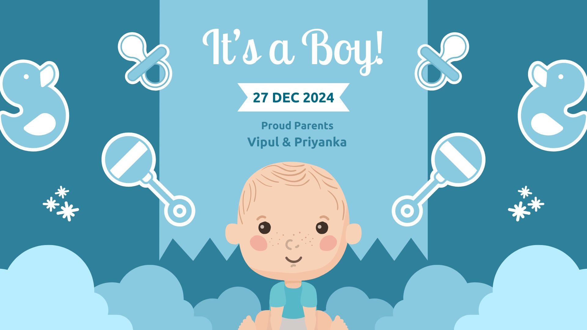

Hi Baby,

I am so delighted that you are born into an amazing family.

Your dada is an incredible human being. He is deeply caring, loving, and affectionate. He will go to any lengths to protect you and ensure your happiness. He will love you to the moon and back.

Your mama is a strong, brave lady. She will cherish you and shower you with cuddles and stories.

Your paternal ajji is the most affectionate, caring, strong, and powerful lady that I know of. She is courageous & jugaadu to the next level. Your ajoba has weathered many storms fearlessly. He is the iron man of our family.

Your maternal ajji & ajoba are kind, affectionate, foodies and will pamper you to the fullest. You will have a fun life, I bet!

May you be blessed with good health, love, happiness, and prosperity. I want the best for you, always and forever.

I don't know what bond I'll share with you because:

1. I am very introverted, and sharing emotions doesn't come to me naturally. But I swear I'll try for you.
2. I don't share a great bond with your mom, but I promise to be your silent cheerleader and greatest well-wisher.

I'm crying so much right now, just like I did when I first found out you were "on the way" in your mama's tummy. I don't know why. I've never felt so happy that I would cry. This is only the second time it's happened, and it's all because of you.

I know you'll probably never read these little notes I'm writing for you. Maybe you won't even like me, just like your mama doesn't. But I love you very much, our little bundle of joy.

You will always be like a son to me. You will be loved deeply, even if I don't show it. You are already my superstar, and I can't stop crying because of how much you mean to me.

I love you, baby. Welcome to this world! I hope you have the most amazing journey here, and may your little footprints leave a big mark on the world.

I made this card for you, which I didn't end up sharing with others.

I got to know you were born after your dada already put it on the family chat with a not so cute "It's a boy" post.

I'm mad because I had a better, cuter and nicer post. I spent time preparing this card for your arrival. This is the least I could do, right?

But you being born, safe, healthy & happy is what matters the most to me as well. But sharing it with you or sort of documenting it for myself..

First something I made for you..

Okay, I don't know your name yet, but I hope you have a fun time baby!

Your mama, dada & ajjiu ajoba will take good care of you. Don't trouble them too much, okay?

Okay, I need to stop writing now. Else I will go on & on & on.
